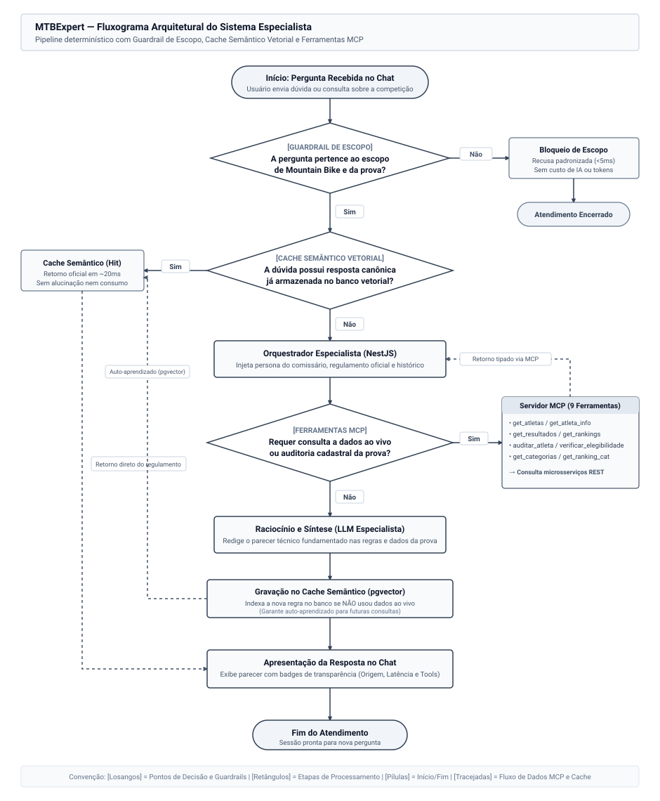

# MTBExpert — Comissário Técnico Virtual de Mountain Bike (MTB)

**Pós-Graduação em Desenvolvimento Web / Sistemas Especialistas para Web**  
**Instituto Federal da Bahia (IFBA)**

- **Docente:** Prof. Dr. Luis Paulo da Silva Carvalho
- **Discente:** Iago da Silva Oliveira
- **E-mail:** 20261dweb0019@ifba.edu.br
- **Mini-Mundo:** Arbitragem Regulamentar, Enquadramento de Categorias e Análise em Tempo Real de Competições de Mountain Bike (MTB)

---

## 📌 Contexto de Avaliação: Evolução do Projeto e Escopo da Atividade

> [!IMPORTANT]
> Este projeto é uma continuação e evolução arquitetural da atividade desenvolvida na disciplina anterior (_Desenvolvimento de Aplicações Orientadas a Serviços_), cujo código-fonte original está disponível em: **[github.com/Mtb-Iago/pos-graduacao-mcp-atividade](https://github.com/Mtb-Iago/pos-graduacao-mcp-atividade)**.
>
> Na disciplina anterior, foram criados os microsserviços de negócio (`service-atletas`, `service-resultados`, `service-rankings`) e o servidor de ferramentas `mcp-server`.
>
> **O que foi desenvolvido EXCLUSIVAMENTE para esta atividade de Sistemas Especialistas:**
> Todo o núcleo de Inteligência Artificial, Arbitragem Regulamentar, Raciocínio Especialista e Avaliação foi implementado de forma inédita nesta tarefa, concentrado nos seguintes arquivos e módulos:

| Novo Componente / Módulo                        | Diretório / Arquivo                                                                                    | O que foi implementado nesta atividade                                                                                                                                        |
| ----------------------------------------------- | ------------------------------------------------------------------------------------------------------ | ----------------------------------------------------------------------------------------------------------------------------------------------------------------------------- |
| **Orquestrador Especialista** (`expert-system`) | [`expert-system/`](expert-system/)                                                                     | Microsserviço inédito em NestJS estruturado em **Clean Architecture (Hexagonal)** com injeção de dependência e desacoplamento via Ports & Adapters.                           |
| **Cache Semântico Vetorial Local**              | [`expert-system/src/infrastructure/cache/`](expert-system/src/infrastructure/cache/)                   | Mecanismo de aceleração semântica com busca vetorial de cosseno sem custo de tokens para regras canônicas.                                                                    |
| **Banco de Dados Vetorial** (`db-expert`)       | [`init-expert.sql`](init-expert.sql)                                                                   | Novo contêiner PostgreSQL 15 com extensão `pgvector` e índice **HNSW** (`vector_cosine_ops`).                                                                                 |
| **Provedor de Embeddings ONNX Local**           | [`expert-system/src/infrastructure/embedding/`](expert-system/src/infrastructure/embedding/)           | Vetorização local de 384 dimensões usando o modelo multilingual `MiniLM` via biblioteca `@huggingface/transformers` (100% offline).                                           |
| **Guardrail de Escopo e Domínio**               | [`expert-system/src/infrastructure/guardrail/`](expert-system/src/infrastructure/guardrail/)           | Filtro determinístico de entrada que bloqueia perguntas fora do domínio de MTB em menos de 5ms.                                                                               |
| **Persona do Comissário Técnico**               | [`expert-system/src/application/persona.builder.ts`](expert-system/src/application/persona.builder.ts) | Engenharia de prompt rica com regulamento oficial da CBC/UCI e regras de enquadramento (idade, peso, E-Bike e PNE).                                                           |
| **Avaliador Automatizado LLM-as-a-Judge**       | [`expert-system/judge/`](expert-system/judge/)                                                         | Script autônomo de auditoria com dataset de 12 casos de teste avaliando acurácia regulamentar, assertividade de dados e alucinação.                                           |
| **Widget Flutuante Conversacional**             | [`cliente-web/`](cliente-web/)                                                                         | Adição da interface de chat do Comissário Virtual sobre o dashboard com suporte a expansão/restauração, chips rápidos e badges de rastreabilidade (Origem, Latência e Tools). |

---

## ⚡ Guia Rápido: Como Executar o Projeto

### Pré-requisitos

- [Docker](https://docs.docker.com/get-docker/) e [Docker Compose](https://docs.docker.com/compose/) instalados.
- Navegador moderno (Chrome, Firefox, Safari ou Edge).
- Chave de API da Google Gemini ([Google AI Studio](https://aistudio.google.com/)).

### Passo a Passo de Execução

1. **Configurar variáveis de ambiente**:

   ```bash
   cp .env.example .env
   # Abra o .env e insira sua chave GEMINI_API_KEY
   ```

   _(Nota: O Guardrail e o Cache Semântico funcionam localmente sem chave. A chave GEMINI_API_KEY é necessária para o raciocínio generativo da LLM e para a execução do avaliador LLM-as-a-Judge)_.

2. **Subir toda a infraestrutura com Docker**:

   ```bash
   docker compose up -d --build
   ```

   _São inicializados automaticamente 8 contêineres: 3 bancos PostgreSQL (incluindo pgvector), 3 microsserviços de dados, 1 servidor MCP e o orquestrador especialista._

3. **Acessar a Aplicação**:
   - **Dashboard & Chatbot do Comissário:** Abra o arquivo `cliente-web/index.html` diretamente no seu navegador.
   - **Servidor MCP (Protocolo de Ferramentas):** [http://localhost:8000/mcp](http://localhost:8000/mcp)

4. **Rodar a Avaliação Automatizada (Script Independente - Item 4 do Descritivo)**:
   ```bash
   docker compose exec expert-system npm run judge
   ```
   _Executa o dataset de 12 casos de teste avaliando Acurácia Regulamentar, Assertividade em Dados e Ausência de Alucinação (notas de 0 a 10) e gera relatório JSON consolidado em `expert-system/judge/reports/`._

---

## 🚴 Visão Geral do Produto e Mini-Mundo

O **MTBExpert** atua como um Comissário Técnico Virtual e Diretor de Prova oficial, auxiliando atletas e comissários na interpretação do regulamento oficial da CBC/UCI e na consulta a dados em tempo real da prova:

1. **Arbitragem Regulamentar Estrita:**
   - **E-Bikes:** Corte obrigatório aos 25 km/h, potência contínua máx. de 250W e proibição taxativa de acelerador manual (Art. 5º).
   - **Categorias Especiais:** Peso Pesado (90kg e 100kg), regras e laudo médico para PNE/PCD e Duplas Mistas.
   - **Penalidades e Resultados:** Interpretação de status DNF (_Did Not Finish_), DNS (_Did Not Start_) e critérios etários e cronométricos de desempate.
2. **Auditoria Cadastral Proativa:**
   - Detecta irregularidades em inscrições de atletas (ex.: atleta inscrito em categoria convencional de Elite portando bicicleta elétrica).
3. **Consulta de Dados em Tempo Real via MCP:**
   - Tempos brutos de prova, posições de ranking geral e classificação filtrada por categoria.

---

## 🔄 Diagrama de Fluxo do Sistema

O fluxo de processamento de qualquer pergunta enviada ao **MTBExpert** segue uma sequência lógica estruturada para garantir precisão regulamentar, respostas ágeis e dados oficiais:



### 🧠 Especificações Técnicas do Cache Semântico Vetorial

Para garantir respostas instantâneas, máxima fidelidade ao regulamento oficial e redução drástica no consumo de tokens da LLM, o sistema implementa um **Cache Semântico Vetorial** de alta performance:

- **Modelo de Embedding Utilizado:** `Xenova/paraphrase-multilingual-MiniLM-L12-v2` (gera vetores densos e normalizados de **384 dimensões**, com excelente suporte semântico para a língua portuguesa).
- **Biblioteca de Execução Local:** `@huggingface/transformers` (executa o modelo localmente no contêiner Node.js via **ONNX Runtime / WebAssembly**, garantindo geração de embeddings sem custo de rede ou dependência de APIs externas de embeddings).
- **Armazenamento e Indexação Vetorial:** Banco dedicado `db-expert` executando **PostgreSQL 15 com extensão `pgvector`**, estruturado com índice vetorial **HNSW** (`idx_cache_embedding_hnsw`) configurado para cálculo de distância por produto de cosseno (`vector_cosine_ops` com o operador `<=>`).
- **Limiar de Decisão (_Cosine Threshold_):** Calibrado em **`CACHE_THRESHOLD=0.72`** (ajustável no `.env`). Perguntas com similaridade semântica $\ge 72\%$ em relação às regras canônicas recebem resposta em cerca de **20ms** diretamente do cache (`Origem: cache_semantico`).
- **Aprendizado Contínuo (_Self-Populating_):** Quando uma pergunta regulamentar inédita é respondida com sucesso pela LLM (sem acionar ferramentas de dados voláteis), a nova pergunta e seu vetor são indexados automaticamente no `pgvector`, tornando o sistema progressivamente mais rápido para os próximos usuários.

### Interpretação do Fluxo Passo a Passo:

1. **Recepção da Pergunta (Chat):** O usuário (atleta, árbitro ou organizador) submete uma dúvida pela interface conversacional.
2. **Guardrail de Escopo (Filtro de Domínio):** O sistema valida deterministicamente se a pergunta pertence ao universo de Mountain Bike e às normas da prova. Assuntos fora de escopo são bloqueados em menos de 5ms, sem acionar a LLM e sem consumir tokens.
3. **Cache Semântico Vetorial (pgvector):** O sistema gera o embedding da pergunta e busca no banco vetorial se já existe uma resposta canônica para aquela dúvida (ex: limite de velocidade da E-Bike, peso de categorias ou critérios de desempate). Havendo correspondência semântica alta (similaridade >= 0.72), a resposta oficial é entregue em cerca de 20ms.
4. **Orquestrador Especialista (NestJS / Arquitetura Hexagonal):** Caso não haja cache imediato, o orquestrador prepara o contexto, injetando as instruções da persona de Comissário Técnico da CBC, os artigos do regulamento oficial e o histórico de mensagens.
5. **Servidor e Ferramentas MCP (Model Context Protocol):** Se a pergunta exigir informações dinâmicas ou auditoria em tempo real, a LLM invoca ferramentas tipadas (Zod) expostas pelo servidor MCP (`get_atletas`, `get_resultados`, `get_rankings`, `auditar_atleta`, `verificar_elegibilidade`), que consultam os microsserviços REST da competição.
6. **Raciocínio e Síntese (LLM Especialista):** Munida dos dados reais retornados pelo MCP e das regras oficiais, a LLM redige o parecer técnico fundamentado.
7. **Gravação no Cache Semântico (Auto-Aprendizado):** Se a resposta gerada pela LLM for puramente conceitual e regulamentar (ou seja, não utilizou ferramentas MCP para consultar dados dinâmicos da corrida como tempos parciais ou posições), o sistema indexa automaticamente a nova pergunta e seu vetor no banco `pgvector`. Dessa forma, o sistema aprende com o uso e passa a responder perguntas idênticas ou similares de forma instantânea em ~20ms para os próximos usuários.
8. **Apresentação com Transparência no Chat:** O usuário recebe a resposta final no chat acompanhada de badges de rastreabilidade, identificando a origem (`Cache Semântico`, `Guardrail` ou `LLM Especialista`), as ferramentas MCP acionadas e a latência exata da operação.

---

## 🏛️ Arquitetura e Microsserviços

O sistema implementa Clean Architecture e Arquitetura Hexagonal (_Ports & Adapters_), garantindo que regras de negócio não dependam de frameworks:

| Contêiner / Serviço  | Porta          | Tecnologias                              | Responsabilidade                                                                         |
| -------------------- | -------------- | ---------------------------------------- | ---------------------------------------------------------------------------------------- |
| `cliente-web`        | Arquivo / HTTP | HTML5, Tailwind CSS, JS                  | Dashboard de resultados + Widget flutuante de chat com botão de **Maximizar/Restaurar**. |
| `expert-system`      | 3005           | NestJS, TypeScript, `@google/genai`      | Orquestrador especialista: Guardrail, Cache Semântico, Persona e integração com MCP.     |
| `mcp-server`         | 8000           | NestJS, `@modelcontextprotocol/sdk`, Zod | Servidor MCP expondo 9 ferramentas tipadas para a LLM.                                   |
| `service-atletas`    | 3001           | NestJS, PostgreSQL                       | Cadastro de 200 atletas e 27 categorias com regras de elegibilidade.                     |
| `service-resultados` | 3002           | NestJS, PostgreSQL                       | Registro de tempos brutos e status de prova (Finalizou, DNF, DNS).                       |
| `service-rankings`   | 3003           | NestJS, PostgreSQL                       | Cálculo de classificação geral e pódios por categoria.                                   |
| `db-expert`          | 5434           | PostgreSQL 15 + `pgvector`               | Banco vetorial de embeddings (índice HNSW com métrica de cosseno).                       |
| `db-atletas`         | 5432           | PostgreSQL 15                            | Banco relacional dos atletas e categorias.                                               |
| `db-resultados`      | 5433           | PostgreSQL 15                            | Banco relacional dos resultados cronometrados e rankings.                                |

---

## 🛠️ Ferramentas MCP Disponíveis (Model Context Protocol)

Todas as ferramentas possuem contratos tipados via schemas **Zod** no servidor MCP:

1. `get_atletas`: Lista atletas com filtro opcional por nome.
2. `get_atleta_info`: Ficha cadastral detalhada (idade, peso, sexo, categoria, e-bike, pcd).
3. `get_categorias`: Lista as 27 categorias e regras estruturadas de idade, peso e sexo.
4. `get_resultados`: Retorna tempos brutos e status oficiais de prova.
5. `get_resultado_atleta`: Consulta o tempo e status de um atleta específico por ID.
6. `get_rankings`: Consulta a classificação geral ordenada por tempo.
7. `get_ranking_categoria`: Consulta a classificação oficial filtrada por ID de categoria.
8. `verificar_elegibilidade`: Motor determinístico que valida se um perfil pode correr em dada categoria.
9. `auditar_atleta`: Motor de auditoria que detecta inconformidades de inscrição (ex: Atleta 150).

---

## ⚖️ Módulo Avaliador: LLM-as-a-Judge

Conforme exigido no **Item 4 do descritivo da disciplina**, a solução inclui um script de auditoria automatizada:

- **Localização:** `expert-system/judge/`
- **Como funciona:** O script roda de forma **independente e assíncrona** (não roda no chat normal dos usuários para não adicionar latência nem custos). Ele lê um dataset curado de 12 perguntas críticas (`judge/dataset.json`), envia cada pergunta ao endpoint do chatbot, recebe a resposta com os metadados (ferramentas MCP utilizadas, tempo de resposta, origem) e submete o resultado ao **Juiz LLM**.
- **Dimensões Avaliadas (Notas de 0 a 10):**
  1. _Acurácia Regulamentar_: Concordância estrita com as regras oficiais da CBC/UCI.
  2. _Assertividade em Dados_: Uso correto de ferramentas MCP sem alucinar números.
  3. _Ausência de Alucinação_: Aderência total aos fatos verificáveis.

### Modelos Utilizados (Assistente vs. Julgador)

| Papel                                         | Modelo Padrão                               | Variável no `.env` | Características                                                                                                        |
| --------------------------------------------- | ------------------------------------------- | ------------------ | ---------------------------------------------------------------------------------------------------------------------- |
| **Assistente Especialista** (`expert-system`) | `gemini-flash-latest`                       | `GEMINI_MODEL`     | Otimizado para baixa latência, conversação ágil e suporte nativo a _function calling_ com o protocolo MCP.             |
| **Juiz / Auditor Chefe** (`judge`)            | `gemini-flash-latest` (ou `gemini-2.5-pro`) | `JUDGE_MODEL`      | Atua como Auditor Chefe com prompt de julgamento técnico e schema JSON estrito de pontuação (requer `GEMINI_API_KEY`). |

---

## 🖥️ Recursos da Interface Web (`cliente-web`)

- **Dashboard Integrado:** Visualização em tempo real de rankings gerais, tempos de prova e lista de inscritos com atualização automática a cada 5 segundos.
- **Widget do Comissário Virtual:**
  - **Botão de Maximizar/Restaurar:** Permite expandir a janela do chat para leitura confortável de tabelas e listas detalhadas.
  - **Chips de Sugestão Rápida:** Atalhos de um clique para dúvidas frequentes (_Regras E-Bike_, _DNF/DNS_, _Auditar ID 150_, _Líder Geral_).
  - **Badges de Origem:** Indicam visualmente se a resposta veio de `⚡ Cache Semântico`, `🛡️ Guardrail de Escopo` ou `🤖 LLM Especialista`, acompanhadas do tempo de resposta em milissegundos.
